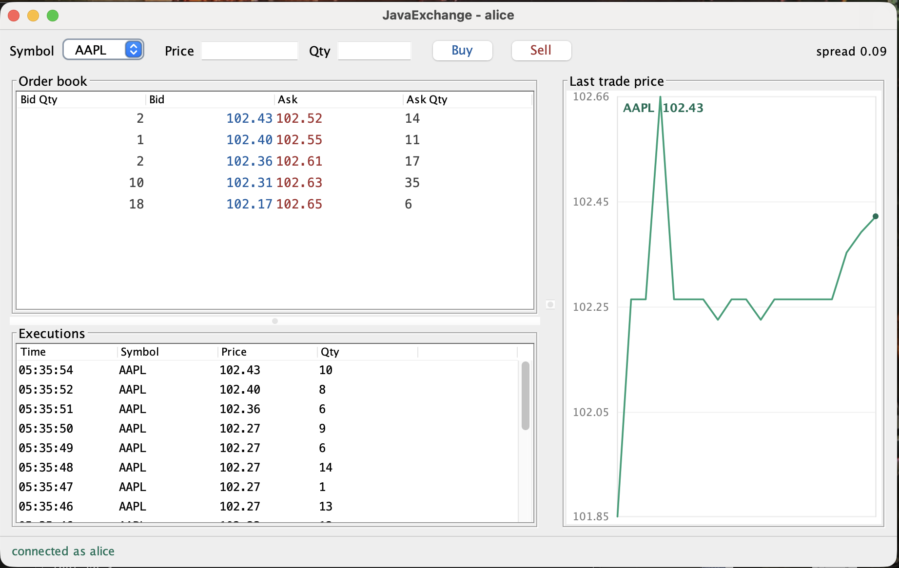

# JavaExchange

**A multi-user limit order book trading system**
NYU Tandon — Introduction to Java (CS6103) — final project

Multiple users each run a Swing client and connect over TCP to a central exchange server. Users submit limit orders; the server maintains a live order book per instrument and matches incoming orders against resting orders by price-time priority. Each execution is published to all connected clients immediately, then settled asynchronously inside one atomic database transaction.

---

## Running it

**Requirements:** JDK 21 or later — record patterns in `switch` are used, which are not valid in 17. The H2 jar is bundled under `lib/`, so nothing needs downloading. On macOS or Linux, make the scripts executable once:

```bash
chmod +x run.sh server.sh client.sh bot.sh
```

Should the jar ever go missing, it can be fetched again from the H2 release page:

```bash
curl -L -o lib/h2-2.3.232.jar \
  https://github.com/h2database/h2database/releases/download/version-2.3.232/h2-2.3.232.jar
```

`./run.sh` builds everything and runs all five test harnesses. It takes about 30 seconds, because the last one runs a live bot market for 12 seconds.

Start a server, then clients and optionally bots, each in its own terminal:

```bash
./server.sh 5555     # the exchange
./client.sh          # a trading client; run two or more
./bot.sh 3           # three bots trading AAPL (./bot.sh 5 MSFT also works)
```

In each client, enter a username and password, press **Register**, then **Log in**. Every new account starts with $1,000,000 and 1,000 shares of each instrument. With bots running, every open client shows the book updating and the chart filling in without anyone clicking anything; the bots are ordinary clients speaking the same protocol over the same sockets, and the server gives them no special treatment.

**Demonstration.** In client B, sell 30 AAPL at 102.00. Client A shows `102.00 / 30` on the ask side without refreshing. In client A, buy 50 at 102.00. Both clients show a 30-share execution, the chart plots the print, and the unfilled 20 shares become the new best bid.

A client with three bots trading against it, showing the live depth ladder, the execution blotter, and the price chart all updating on their own:



The protocol is plain text, so the server can also be driven by hand with `telnet localhost 5555`:

```
REGISTER|alice|pw
LOGIN|alice|pw
ORDER|AAPL|SELL|10200|30
```

---

## Advanced concepts

Five are applied; three are required.

| Concept | Where |
|---|---|
| Threads / concurrency | `MatchingEngine`, `Session`, `ExchangeServer` |
| Networking | `ExchangeServer`, `ClientHandler`, `ServerConnection`, `Protocol` |
| Databases | `TradeDao`, `UserDao`, `Db` |
| GUIs | `LoginFrame`, `TradingFrame`, `PriceChartPanel`, table models |
| Security | `UserDao` — per-user salt plus an application-wide pepper |

---

## Architecture

```
common/   Side, OrderStatus, Order, Trade, MatchResult, BookSnapshot, Money, Protocol
server/   ExchangeServer, ClientHandler, Session, Broadcaster,
          MatchingEngine, OrderBook, db/{Db, UserDao, TradeDao}
client/   LoginFrame, TradingFrame, DepthTableModel, BlotterTableModel,
          PriceChartPanel, ServerConnection
bot/      SimBot
```

**Thread inventory.**

```
1  accept thread            blocks in accept(), hands sockets to the pool
N  client handler threads   one per connection, read and parse only
1  matching thread          sole owner of every OrderBook
1  persistence thread       settles trades in arrival order
N  session writer threads   one per connection, drains an outbound queue
```

**Order book.** Two `TreeMap`s keyed by price — bids descending, asks ascending — so the best level on either side is always `firstEntry()`. Each level holds an `ArrayDeque` of orders in arrival order, which gives time priority within a price level for free: always consume from the head, always append to the tail.

---

## Design decisions

**Matching is single-threaded, on purpose.** The obvious alternative is to lock the order book and let handler threads mutate it directly. Instead every mutation is serialized through one matching thread fed by a `LinkedBlockingQueue`. This removes deadlock and lock-ordering bugs entirely, makes execution order deterministic and therefore reproducible under test, and mirrors how production matching engines are actually built. Concurrency is still genuine and load-bearing — N handler threads accept orders simultaneously, and the queue is the point at which competing requests are given a total order. `OrderBook` is deliberately *not* thread-safe, and says so in its class comment, because that is a design contract rather than an oversight.

**Settlement is atomic.** One execution is four writes: debit the buyer, credit the seller, move the shares, record the trade. Any one landing without the others corrupts the ledger irreparably — the system cannot tell afterwards which half was the truth. `TradeDao.settle` disables autocommit, performs every write on one connection, and commits only at the end; any exception rolls the whole batch back.

**Balance checks live inside the SQL.** The debit is `UPDATE users SET cash_cents = cash_cents - ? WHERE id = ? AND cash_cents >= ?`, so the check and the update cannot be separated by another transaction, as they could be if Java checked first and updated afterwards.

**Persistence runs off the matching thread**, on exactly one thread rather than a pool. Disk I/O is orders of magnitude slower than an in-memory match, so settling inline would let database latency dictate matching throughput; a pool would not preserve the order trades were matched in.

**Orders are risk-checked before they reach the book.** Cash and holdings are verified at submission, so an account that plainly cannot afford an order never reaches the matching engine. This is a check rather than a reservation: because settlement is asynchronous, two orders from the same account submitted within the same instant can both pass, and the second may then fail to settle after its trade has already been published. Closing that window entirely would mean reserving balances inside the matching thread and releasing them on settlement, which is a larger change than this project takes on.

**Passwords use a salt and a pepper.** Each account has its own random salt stored beside the hash, so two users with the same password produce different hashes and no single rainbow table covers the table. The pepper is a second secret mixed into every hash but held outside the database, so a stolen database file alone does not enable an offline dictionary attack. Comparison uses `MessageDigest.isEqual`, which does not short-circuit and so does not leak how much of the hash matched. A production system would use bcrypt or Argon2; SHA-256 stays within the standard library, and the salt-and-pepper structure is what is being demonstrated. Relatedly, a bad username and a bad password both return `invalid credentials`, so the response cannot be used to enumerate accounts.

**Smaller decisions.** Prices are a `long` count of cents, because binary floating point cannot represent 0.10 exactly and a `double` comparison would occasionally fail to match two conceptually identical prices. Trades print at the resting order's price, since that order set the terms first and an aggressor willing to pay more receives price improvement. Every queue is bounded — 512 outbound messages per session, 500 blotter rows, 240 chart points — because a client that stops reading would otherwise grow the server until memory ran out. The schema is a text block in `Db` rather than a classpath resource, since loading DDL from the classpath works only when the build copies non-Java files into the output directory, and IDEs disagree about whether they do.

---

## Testing

Five harnesses, all plain `main` methods with no JUnit dependency. `./run.sh` runs all of them; 105 checks pass.

| Harness | Checks | Covers |
|---|---|---|
| `server.EngineTest` | 36 | matching, priority, cancellation, level-total consistency, 40-thread race |
| `server.db.DbTest` | 21 | hashing, settlement, rollback under injected failure |
| `server.NetworkTest` | 21 | full stack over real sockets, cancellation persistence, 20-client race |
| `client.UiTest` | 22 | table models and chart painting, headless |
| `bot.SimBotTest` | 5 | live four-bot market, cash and share conservation |

**Race conditions.** Two tests attack the same invariant at different levels — 40 threads in-process, then 20 separate clients over real TCP, each firing 10 shares at a resting lot of 100:

```
[race]     executed=100  askRemaining=0  bidsQueued=300
[race/tcp] settled=100   winners=10      makerHolding=900
```

Exactly the resting quantity trades, never more, and the losing orders rest as bids rather than vanishing.

**Atomicity.** A failure is injected after the cash and share writes have been issued but before the commit; the ledger is left exactly as it was:

```
[rollback] crash injected after 4 writes; ledger fully restored
```

**Conservation.** The strongest available statement about the system. An exchange moves cash and shares between accounts but never creates or destroys either, so after a market of bots has traded freely the totals must be what they were at the start:

```
[bots] 38 trades settled
[bots] shares 4000 (expected 4000)
[bots] cash 4000000.00 (expected 4000000.00)
```

The trade count varies between runs, since the bots trade concurrently against a live market; the two totals do not, and those are what the test asserts.

Any interleaving that double-filled an order, dropped a settlement, or committed half a transaction would show up here as drift.

---

## Performance

`./bench.sh` runs `server.EngineBenchmark`, a plain-`main` throughput benchmark of the matching core. Networking and the database are not included. Each round submits 1,000,000 pre-generated orders for one instrument with a fixed random seed: 50/50 buy and sell, limit prices uniform within ±0.50 of 100.00, quantity 1–100. About 78% of orders produce at least one trade. There are 5 warm-up rounds, then the median of 10 measured rounds is reported.

| Path measured | Before (median orders/sec) | After (median orders/sec) |
|---|---|---|
| `OrderBook.submit` (price-time matching only) | ~4.3M | ~4.4M |
| `OrderBook.submit` + 5-level depth snapshot | ~108K | ~2.6M |
| `MatchingEngine` (queue handoff + engine thread + snapshot) | ~106K | ~1.46M |

*Environment: OpenJDK 21.0.12, Linux x86-64, 2 vCPU cloud container; before and after measured on the same machine. Numbers vary by machine; run `./bench.sh` to reproduce.*

**The bottleneck was the depth snapshot, not matching.** After every order the engine builds a snapshot of the top five levels per side. Originally, `OrderBook.levels()` summed the remaining quantity of every order at each of those levels. With this order flow, prices away from the mid never trade, so the book keeps growing and the top five levels can hold thousands of orders. Each snapshot therefore cost O(orders in the top levels) rather than O(levels).

**Fix.** Each price level now keeps a running total of its open quantity, updated when an order rests, fills or is cancelled. A snapshot reads those totals, so it costs O(depth). End-to-end engine throughput rose about 14x. Both runs produce the same 779,162 trades from the same 1,000,000 orders, so matching behavior is unchanged. `EngineTest` checks after every step of a random fill-and-cancel sequence that each level's total equals the sum of its orders.

With the snapshot no longer dominant, the remaining gap between the engine path and matching alone is mostly the queue handoff between threads.

---

## Changes from the proposal

The wire protocol is line-delimited text rather than JSON, which removed a dependency and made the server drivable by `telnet`. The schema moved from a classpath resource into `Db`, for the reason given above. `SimBot` and `SimBotTest` were added: a market that only moves when a human clicks a button is a poor demonstration of concurrency, and the conservation test the bots enable turned out to be the most valuable check in the suite. Pre-trade risk checks were added to reduce avoidable settlement failures, once it became clear that publication happens before asynchronous settlement and a failure at that point has no clean recovery. They narrow the window rather than closing it; the residual race is described under Limitations.

---

## Limitations and possible extensions

The pre-trade risk check is a check rather than a reservation, as described above, so a settlement can still fail after its trade has been published. Only limit orders are supported, and there is no order modification — only cancel and resubmit. The book is held in memory, so a restart loses resting orders; they are persisted but not replayed. Market data is broadcast to every client regardless of the instrument being viewed, with filtering done client-side, where a subscription model would scale better. SHA-256 should be Argon2 in any real deployment.

---

## Notes

External libraries: H2 Database Engine, used as an embedded store and accessed only through standard JDBC, so the code remains portable to any JDBC provider. No game, GUI, or networking framework is used; all sockets, threading, and Swing components are written directly. All source code is written from scratch for this course and has not been submitted for any other course.
